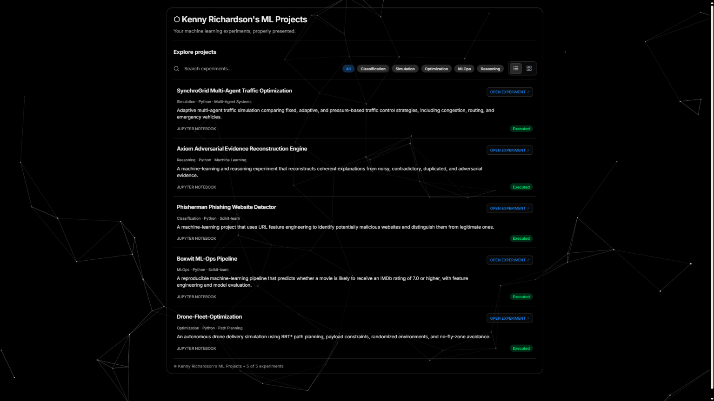
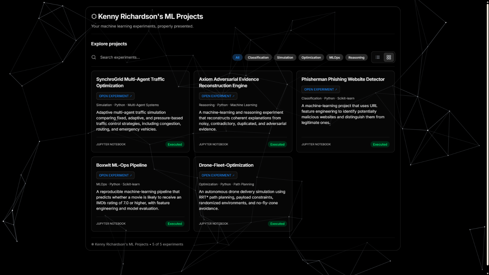

# ⬡ My ML Projects

A curated collection of machine learning and AI engineering projects by **Kenny Richardson**.

> ⚛️ A collection of machine learning projects exploring classification, optimization, multi-agent simulation, adversarial reasoning, and MLOps. Built to experiment, solve practical problems, and turn ideas into working systems.

## 🚀 Projects

### 1. 🚦 [SynchroGrid: Multi-Agent Traffic Optimization](https://github.com/kennykrichardson/SynchroGrid-Multi-Agent-Traffic-Optimization)
A multi-agent traffic optimization project focused on coordinating traffic flow and exploring intelligent, distributed decision-making.

**🎯 Focus:** Multi-agent systems · Traffic optimization · Simulation

### 2. ⚖️ [Axiom: Adversarial Evidence Reconstruction Engine](https://github.com/kennykrichardson/Axiom-Adversarial-Evidence-Reconstruction-Engine)
An adversarial reasoning project centered on reconstructing and evaluating evidence through competing perspectives.

**🎯 Focus:** Adversarial reasoning · Evidence analysis

### 3. 🛡️ [Phisherman: Phishing Website Detector](https://github.com/kennykrichardson/Phisherman-Phishing-Website-Detector)
A machine learning project that analyses website features to identify potentially malicious or phishing websites.

**🎯 Focus:** Classification · Cybersecurity · Detection

### 4. ⚙️ [Boxwit: ML-Ops Pipeline](https://github.com/kennykrichardson/Boxwit-MLOps-Pipeline)
An ML-Ops project focused on organizing and executing the stages of a machine learning workflow.

**🎯 Focus:** MLOps · Pipeline automation

### 5. 🚁 [Drone Fleet Optimization](https://github.com/kennykrichardson/Drone-Fleet-Optimization)
An optimization project exploring the coordination and efficient allocation of tasks across a drone fleet.

**🎯 Focus:** Optimization · Fleet coordination

## 🖼️ Screenshots

### 📋 ML Projects List

### 🗂️ ML Projects Grid

## 🧩 Project Areas

- **🏷️ Classification:** Learning from data to distinguish between categories.
- **📈 Optimization:** Finding efficient solutions under defined constraints.
- **🤖 Multi-Agent Simulation:** Studying coordination and decision-making among autonomous agents.
- **⚔️ Adversarial Reasoning:** Examining evidence and competing hypotheses.
- **🔄 MLOps:** Structuring repeatable machine learning workflows.

## 👨‍💻 Author

**Kenny Richardson**

- 🐙 GitHub: [@kennykrichardson](https://github.com/kennykrichardson)
- 🌐 Portfolio: [kennykrichardson.onrender.com](https://kennykrichardson.onrender.com)

## 📄 License

Unless a project repository states otherwise, the contents of this collection are provided under the [MIT License](LICENSE).